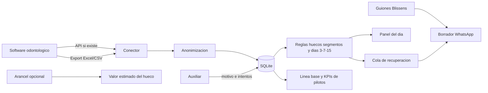

# Prototipo de recuperación y agenda Blissens

App web local (Streamlit + SQLite) que toma la agenda del software odontológico, la guarda en una base propia y le dice a la auxiliar cada día qué huecos hay, a quién contactar y en qué orden. Hace seguimiento con fechas fijas (días 3, 7 y 15) a quienes cancelaron, no asistieron o dejaron un tratamiento a medias. Así el seguimiento deja de depender de la memoria de la auxiliar y la clínica empieza a tener datos: tasa de no asistencia, recuperación y motivos de cancelación.

El envío de WhatsApp sigue siendo **manual**: la app solo prepara el borrador y lo copia.

## Qué cambia frente a la propuesta anterior

| Tema | Antes | Ahora |
|---|---|---|
| Almacenamiento | Leer el Excel anonimizado en memoria; "base de datos propia" fuera del MVP | **SQLite** (un solo archivo, sin servidor) es parte del MVP |
| Origen de datos | Carga manual del Excel | **Extracción automática**: API del software si existe; si no, lectura automática del archivo exportado |
| Seguimiento | Cola priorizada con motivo | Cola en **3 grupos** con alerta fija del **día 3, 7 o 15** |
| Registro | Solo lectura | Se registra **motivo de cancelación** (obligatorio), **intentos de contacto** y resultado |
| Validación | Probar un día del Excel | **Prueba 1** (mes pasado vs. cierre manual) y **Prueba 2** (piloto de 2 semanas) con **línea base** previa |

## Tareas

1. Identificar el software de agenda y su forma de extraer datos (API o exportación) y definir el esquema SQLite.
2. Preparar el dataset de trabajo anonimizado a partir de `Agenda citas y estados` y `Agenda y citas` (sin nombres, teléfonos, emails ni cédulas).
3. Construir el conector (API o lectura del export) y la carga automática e idempotente a SQLite.
4. Programar las reglas: huecos, prioridad de la cola, 3 segmentos y alertas de día 3, 7 y 15.
5. Conectar las plantillas de `Guiones_Blissens_` (confirmación, reprogramación, recuperación de inactivo, seguimiento por tratamiento pendiente).
6. Armar la app Streamlit: panel del día, cola de recuperación, registro de motivo e intentos, mensaje copiable.
7. **Calcular la línea base** con datos históricos (antes del piloto).
8. **Prueba 1:** correr agosto por la app y comparar con el cierre de mes manual de la auxiliar.
9. **Prueba 2:** piloto de 2 semanas con la auxiliar; medir contra la línea base; ajustar.
10. Validar privacidad: nada de datos personales expuestos ni versionados.

## Estado

- Hecho: esquema SQLite (`src/db.py`), carga anonimizada e idempotente (`src/load.py`), línea base (`src/baseline.py`, salida en `data/linea_base.json`).
- Hecho: reglas de cola, huecos, alertas 3/7/15 y registro de intentos (`src/rules.py`); plantillas de WhatsApp (`src/messages.py`); pantalla Streamlit (`app.py`).
- Pendiente: conector API/export automático, prueba con la auxiliar, Prueba 1 y Prueba 2.
- Comandos: `python -m src.load`, `python -m src.baseline [--hasta AAAA-MM-DD]` y `streamlit run app.py`.

## Material disponible

Todos los documentos iniciales están en la carpeta `documentos iniciales/`.

- `_Descripción del proceso actual.pdf`: agenda en software + WhatsApp; recordatorio automático 48–24 h; cancelaciones sin reagendar; sin protocolo a 3/7/15 días; recuperación manual al cierre de mes.
- `Agenda citas y estados .xlsx`: 885 citas (ago–nov 2026), 255 pacientes, estados (`Atendido`, `Cambio de fecha`, `Anulado`, `No asiste`, confirmaciones WhatsApp/teléfono, etc.). Sin hora.
- `Agenda y citas .xlsx`: ~231 citas con `Hora Inicio/Fin`, comentario del servicio y datos de contacto. Cruza por `# Cita` / `# Paciente`.
- `Guiones_Blissens_.xlsx`: plantillas reales por etapa (captación, confirmación, reprogramación, seguimiento/reactivación).
- `Arancel precios.xlsx`: precios por acción (valor estimado del hueco, opcional).
- `Propuesta_equipo_MVP_Blissens.docx`: propuesta previa del equipo (esta versión la amplía).
- Ficha del reto: `Programación_Eme_y_Eme_Group_Blissens_Odontología_Reto.pdf`.

**Faltan para las pruebas** (pedir a la clínica):

- La lista de pacientes perdidos que la auxiliar encontró **a mano en el cierre de agosto** (insumo de la Prueba 1).
- Confirmar qué software usan y si su API tiene costo (define si se usa API o exportación).
- Autorización escrita de la clínica para acceder a la API o al export.

## Recursos

- Computador de la clínica o del equipo.
- Python, Streamlit, pandas, SQLite (incluido en Python), VS Code y Git/GitHub (todos gratuitos).
- Acceso a la API o al export del software, con autorización de la clínica. Si el proveedor cobra el acceso a la API, ese costo no es del equipo: se usa la exportación.
- Datos anonimizados de 2 o 3 meses de agenda (ya se tienen ago–nov 2026).
- Guion de mensajes de Blissens.
- Tiempo de la auxiliar para validar y para el piloto.

## Privacidad

Los Excel traen nombres, celulares, emails y documentos reales.

- Repositorio y demos: solo la copia anonimizada (`paciente_id`, sin PII). La UI no muestra ni exporta datos identificables.
- `data/*.db` y los Excel originales van en `.gitignore`; nunca se suben a GitHub.
- Piloto con datos reales: la base SQLite vive únicamente en el computador de la clínica, con autorización. El teléfono no se guarda en la base; la auxiliar lo consulta en el software al enviar el mensaje manual.
- Demo pública solo con datos anonimizados y revisión previa, como pide la ficha.

## Solución

### Flujo

### Extracción automática

1. **API del software**, si existe y es gratuita para la clínica.
2. **Si no:** lectura automática de la carpeta donde se deja el archivo exportado (detecta archivo nuevo, valida columnas, carga).

La carga es idempotente: `# Cita` es la clave, así que re-ejecutar no duplica; si cambia el estado de una cita, se actualiza y se guarda el cambio en el historial.

### Esquema SQLite (propuesto)

- `pacientes(paciente_id, tipo_paciente, antiguedad)`: sin PII.
- `citas(cita_id, paciente_id, fecha, hora_inicio, hora_fin, servicio, estado_normalizado, estado_original, fuente, cargada_en)`.
- `eventos_perdida(evento_id, cita_id, paciente_id, tipo, fecha_evento, motivo_cancelacion, estado_cola)`: `tipo` ∈ cancelación, no asistencia, tratamiento interrumpido, inactivo.
- `intentos_contacto(intento_id, evento_id, fecha, dia_protocolo, canal, resultado, nota)`: `dia_protocolo` ∈ 3, 7, 15; `resultado` ∈ sin respuesta, reagendó, rechazó, otro.
- `huecos(fecha, hora_inicio, hora_fin, cita_origen_id, ocupado_por_cita_id)`.

**Motivo de cancelación:** campo obligatorio que llena la auxiliar al registrar o contactar una cancelación. Los Excel actuales **no traen** motivo, así que el histórico queda como `Sin registrar`; el dato nace con la app.

### Reglas

Tomadas de `_Descripción del proceso actual.pdf` y ampliadas:

- **Hueco:** cita de la fecha seleccionada en anulado / no asiste / cambio de fecha sin nueva cita ocupando el cupo. Horario desde `Agenda y citas`.
- **Pendiente de reprogramar:** paciente con anulado/no asiste y sin cita posterior `Atendido` o confirmada.
- **Estados a normalizar:** `Atendido`, `Anulado`, `Anulado por pcte. via Whatsapp`, `No asiste`, `Cambio de fecha`, `Confirmado por teléfono`, `Confirmado por pcte. vía WhatsApp`, `No confirmado`, notificaciones WhatsApp/email.

### Cola de recuperación (3 grupos)

| Grupo | Quién entra |
|---|---|
| **Tratamiento interrumpido** | Canceló/no asistió o dejó un plan de tratamiento (diagnóstico/revisión atendida) sin cita de continuación |
| **Paciente nuevo que no volvió** | Paciente `Nuevo` sin cita posterior a su primera cita (atendida, cancelada o no asistida) |
| **Inactivo > 3 meses** | Sin cita en más de ~90 días |

**Alertas fijas:** el contador parte de la `fecha_evento` (cancelación, no asistencia o última cita). Cada paciente sale con alerta **Día 3**, **Día 7** o **Día 15** según los días transcurridos y los intentos ya registrados. Pasado el día 15 sin respuesta se cierra el seguimiento como `Sin recuperar`; el paciente puede reentrar como inactivo > 3 meses.

**Prioridad dentro de cada grupo:** alerta vencida primero (15 > 7 > 3), luego antigüedad (Antiguo > Nuevo), luego valor estimado (comentario/arancel). El campo internacional/deportista no viene en los Excel: flag editable o proxy simple.

**Cruce con huecos:** para cada hueco del día se sugiere el candidato de la cola con mejor prioridad.

### Panel del día

Selector de fecha. Muestra ocupación, no asistencias, cancelaciones y huecos (con candidato sugerido), y la cola con grupo, alerta 3/7/15 y botón para registrar intento + resultado + motivo.

### Mensaje de WhatsApp

Plantilla de `Guiones_Blissens_` según el grupo y el tratamiento pendiente, con `[NOMBRE]` genérico, fecha y hora. Botón de copiar. No se envía nada desde la app.

## Qué entra en el MVP

- Extracción automática (API o export) y carga a SQLite.
- Historial: citas, estado, motivo de cancelación obligatorio, intentos de contacto y resultado.
- Panel del día: ocupación, no asistencias, cancelaciones, huecos.
- Cola con 3 grupos y alertas de día 3, 7 y 15.
- Mensaje de WhatsApp personalizado + botón de copiar (envío manual).
- Cálculo de línea base y reporte de pilotos.

**Fuera del MVP:** login, envío automático por WhatsApp API, inteligencia artificial predictiva, reemplazo del software de agenda.

## Cómo se comprueba que funciona

### Paso previo: línea base (antes de la Prueba 2)

Sin la cifra de antes no se puede demostrar mejora. Se calcula con la carpeta histórica **antes** de arrancar el piloto, y se congela:

- Tasa de no asistencia = `No asiste` / citas agendadas del periodo.
- Tasa de cancelación = anulados / citas agendadas.
- **% de cancelaciones y no asistencias reagendadas** = pacientes con cita posterior atendida o confirmada dentro de 15 días / total de eventos.
- **Huecos ocupados** = huecos cuyo cupo fue tomado por otra cita (solo medible donde hay hora).
- Recuperación de inactivos: pacientes que volvieron tras 90+ días sin cita.

Limitaciones a declarar: los datos van de ago–nov 2026; solo ~231 citas traen hora (la ocupación de huecos es aproximada); el motivo de cancelación no existe en el histórico. El periodo del piloto se excluye de la línea base.

### Prueba 1: mes pasado

Se pasan los datos de agosto por la app y se comparan con la lista que la auxiliar encontró a mano en el cierre de mes.

**Esperado:** la app encuentra al menos los mismos pacientes perdidos, más otros que se pasaron, en minutos y no en horas. Se registra: pacientes encontrados por la auxiliar, por la app, intersección, solo-app y solo-auxiliar (revisar cada falso negativo).

### Prueba 2: piloto de 2 semanas

La auxiliar usa la app todos los días. Se miden, contra la línea base:

- % de cancelaciones/no asistencias que se reagendan.
- Cuántos huecos se ocupan.
- Intentos registrados por día 3/7/15 y resultados.
- Motivos de cancelación capturados (completitud del campo obligatorio).
- Tiempo diario que toma la gestión.

Se ajustan reglas y mensajes con la auxiliar durante y al final del piloto.

## Archivos a crear

- `data/agenda_anonimizada.xlsx`: join de estados + horas, sin PII (para demo).
- `data/blissens.db`: base SQLite (ignorada en git).
- `src/db.py`: esquema y acceso a SQLite.
- `src/connector.py`: extracción por API o lectura automática del export.
- `src/load.py`: Excel → anonimización → esquema interno → carga.
- `src/rules.py`: huecos, 3 grupos, alertas 3/7/15, prioridad, cruce.
- `src/messages.py`: plantillas desde `Guiones_Blissens_.xlsx`.
- `src/baseline.py`: línea base y métricas de las pruebas 1 y 2.
- `app.py`: UI Streamlit.
- `requirements.txt`, `README.md`, `.gitignore`.

Los Excel originales se dejan en la carpeta como fuente; la app solo abre la copia anonimizada.
